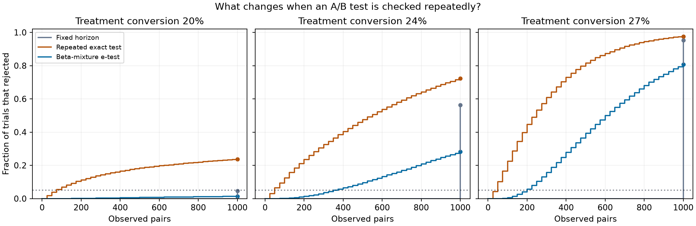

# Sequential A/B Lab

What happens to a 5% test when a team checks it every 25 observations? This simulation compares a fixed-horizon exact test, repeated use of the same exact test, and a beta-mixture e-test on paired binary outcomes.



## Reproduce

Use Python 3.13. The simulation needs no external data.

```sh
python -m pip install -r requirements.txt
python -m unittest -v
python experiment.py
```

## Results

20,000 trials per scenario, up to 1,000 pairs per trial, with control conversion fixed at 20%. Rates count trials that rejected by the horizon.

| Test | 20% treatment (null) | 24% treatment | 27% treatment |
| --- | ---: | ---: | ---: |
| Fixed horizon | 4.64% | 56.24% | 95.30% |
| Repeated exact test | 23.62% | 72.31% | 97.64% |
| Beta-mixture e-test | 1.40% | 28.25% | 80.74% |

Repeated significance checks produced false positives in nearly one quarter of the null trials. The e-test controlled false positives and had lower power by this horizon. Its error guarantee is an upper bound. The chosen prior, look schedule, and finite horizon all affect the observed rates. The [machine-readable results](results/results.json) include Monte Carlo standard errors and first crossing summaries.

## Model and derivation

Each pair contains independent Bernoulli outcomes from the two arms. A treatment win is a pair in which only treatment converts, and a loss is a pair in which only control converts. Under equal conversion probabilities, conditional on a discordant pair, the win probability is 1/2. Ties contribute no sign information.

For w wins and l losses, the exact two-sided p-value is twice the lower binomial tail at min(w, l), capped at 1. The e-test instead integrates the likelihood ratio for a Bernoulli sign probability against a Beta(20, 20) prior fixed before simulation. Its e-value is:

```text
E(w,l) = 2^(w+l) × Beta(w+20,l+20) / Beta(20,20)
```

Under the null, this mixture starts at one and its conditional expected value after the next observation equals its current value. Ties leave it unchanged. Ville's inequality bounds the chance of ever reaching 1/alpha by alpha. The test suite checks the one-step martingale identity and agreement between the two exact-test rules when there is only one look.

The simulation assumes independent pairs with fixed arm probabilities and evaluates synthetic effects. See [Howard et al., Time-uniform, nonparametric, nonasymptotic confidence sequences](https://arxiv.org/abs/1810.08240) for the underlying sequential inference framework.
